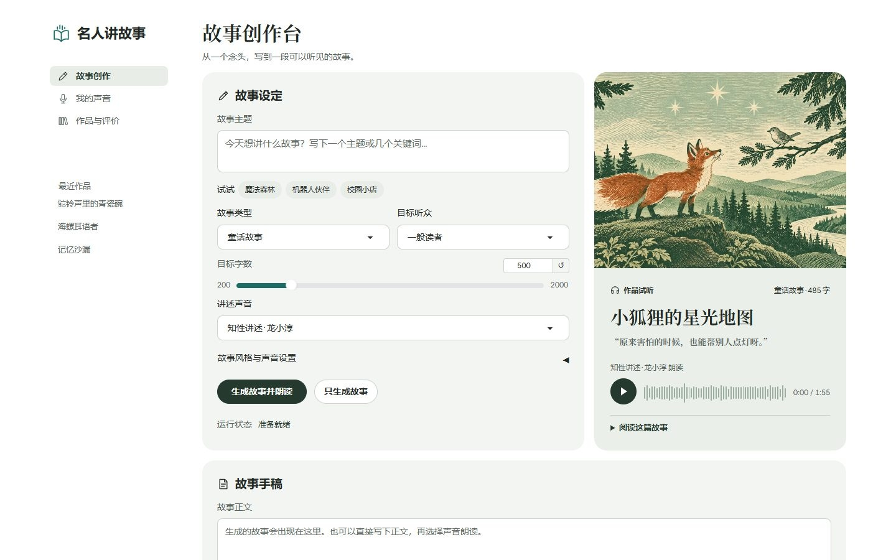
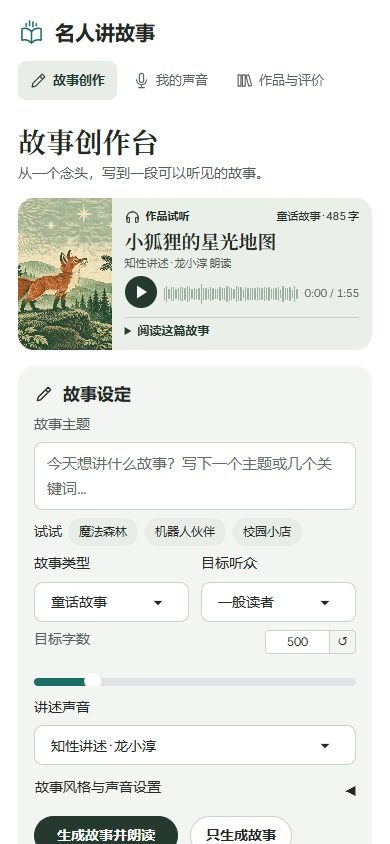
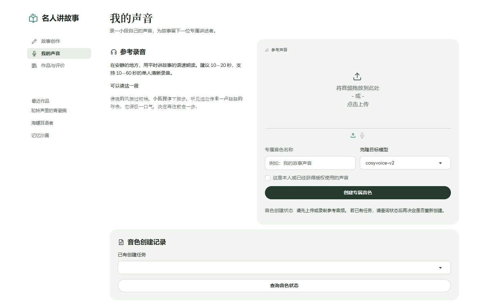

# 名人讲故事 · Celebrities Tell Stories

基于 Gradio、通义千问和 CosyVoice 的中文有声故事应用。选择题材、听众和讲述声音，输入主题后即可生成故事并朗读。

## 功能

- 十类故事，目标长度 200–2000 字，默认 500 字。
- 支持只生成故事、改写和换声重读。长文按句分段合成，保存为 WAV。
- 作品库保存正文和音频版本，支持同文对照试听与评价。
- 支持语音输入主题、录音或视频选段，以及经授权的本人音色创建。

## 本地运行

需要 Python 3.12。安装依赖后，将 `.env.example` 复制为 `.env`，在本地填写自己的 `DASHSCOPE_API_KEY`，并确认百炼服务地域和模型权限。

```bash
python -m venv .venv
```

激活虚拟环境后执行：

```bash
python -m pip install -r requirements.txt
python app.py
```

浏览器打开 `http://127.0.0.1:7860`。首页内置虚拟音色样例可直接试听。生成、语音识别和音色创建使用本机百炼配置。视频取声需要 FFmpeg。

## 界面预览

桌面创作台可设置主题、听众、字数和音色。右侧是内置童话的试听播放器。



| 手机端试听 | 我的声音 |
| --- | --- |
|  |  |

## 从主题到朗读

1. 打开「故事创作」，在「故事主题」输入一句话，例如「一只小狐狸在森林里帮迷路的小鸟找家」。
2. 选择「童话故事」和目标听众，将「目标字数」设为 500，再选择「讲述声音」，例如「知性讲述 · 龙小淳」。
3. 点击「生成故事并朗读」。程序把主题和所选参数交给文本模型，生成的正文会显示在「故事手稿」。接着，CosyVoice 用所选音色分段合成语音，应用将各段写入一个 WAV 文件。
4. 合成完成后，在「故事音频」中点击播放。也可以到「作品与评价」载入已保存的作品并试听。

想先审阅正文，可以点击「只生成故事」。已有正文时，换一个音色再点击「只重新合成语音」，即可试听同一篇故事的另一种朗读。

## 代码结构

| 文件 | 用途 |
| --- | --- |
| `app.py` | Gradio 界面与交互 |
| `prompts.py`、`story_generator.py` | 提示词与故事生成 |
| `tts_engine.py`、`audio_utils.py` | 分段朗读与音频处理 |
| `voice_clone.py`、`voices.py` | 音色管理 |
| `records.py`、`workflow.py` | 作品存储与业务流程 |

运行本地测试：

```bash
python -m pip install -r requirements-dev.txt
python -m pytest -q
```

运行记录保存在本地 `results/`，自定义音色记录保存在本地 `data/`。请将真实密钥保存在本地 `.env`。字体许可见 `ui/assets/`。
